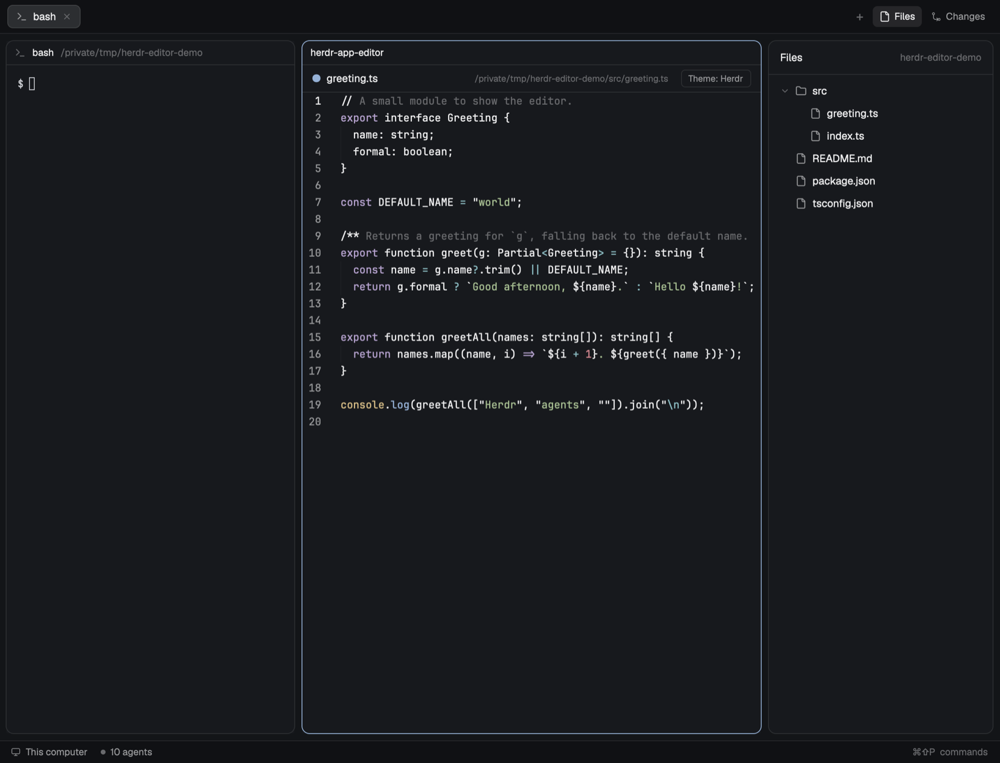

# herdr-app-editor
Native, extensible code editor mod for Herdr Desktop



See [RECIPE.md](RECIPE.md) for what it does and how it is built, and [docs/extensions.md](docs/extensions.md) for extensions.

## Install

Requires Herdr Desktop 0.1.16 or later and [Bun](https://bun.sh) 1.3.5 (`mise install`; run `mise trust` once if mise reports the config as not trusted). Herdr must be running.

```sh
bun install
bun run install:herdr     # builds, copies mods/ and layouts/herdr-app-editor.json into the app home, switches to the "herdr-app-editor" layout
bun run uninstall:herdr   # closes editor panes, switches back to the previous layout, removes the files
```

In the Files panel, click a file to open it in the editor; cmd-click (ctrl-click on Linux/Windows) opens it in a new editor pane. Save with cmd-s / ctrl-s.

## License

[Apache-2.0](LICENSE). `mods/herdr-app-editor-files` is a modified copy of Herdr's `files` mod ([herdrdev/herdr-app](https://github.com/herdrdev/herdr-app), Apache-2.0); its icons are from [Lucide](https://lucide.dev) (ISC, `LICENSE-Lucide.txt`).
