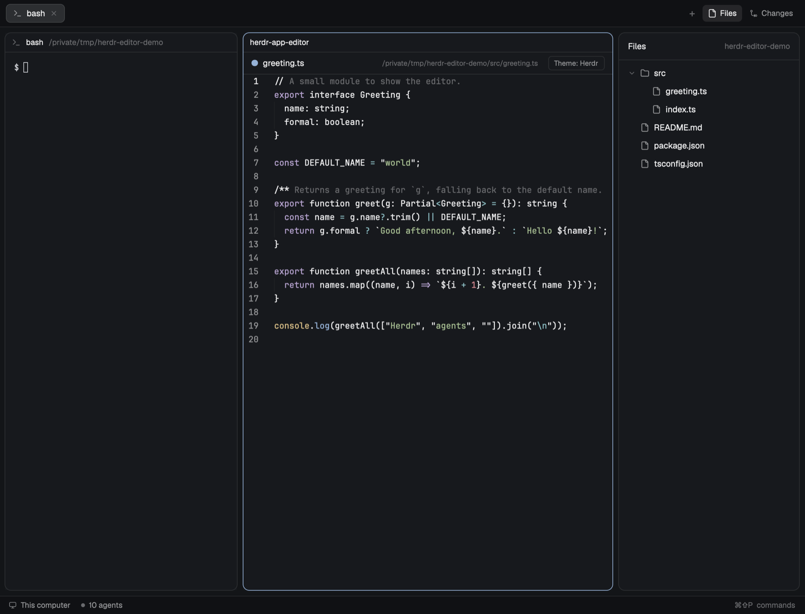

# Herdr Editor

This layout works like Herdr's own `main` layout, except the Files panel opens files in an editable editor pane. You edit with syntax highlighting and line numbers and save with cmd-s (ctrl-s on Linux and Windows). Agents and terminals keep running beside it. Unsaved edits are marked, survive closing the pane, and are never written over a file that changed on disk.

## What you see

- The whole window is Herdr's `main` layout (spaces and agents on the left, tabs on top, Files and Changes panels on the right, status bar), cloned unchanged except for one block. The Files panel block (`id: "files"`) shows the `herdr-app-editor-files` mod instead of `files`.
- **Files panel (`herdr-app-editor-files`):** the same tree as Herdr's Files panel, with the same 28 px rows, chevrons, folder and file icons and git marks. It follows the folder of the focused terminal. While an editor pane has focus, it follows a terminal in the same tab instead.
- **Editor pane (`herdr-app-editor`)**, split to the right of the pane that was focused:
  - Header, 34 px high, 12 px side padding, bottom border `theme().border`. From left to right:
    - a `●` dirty mark in `theme().accent` while the content differs from the file on disk
    - the file name in semibold
    - the full path in 11 px `theme().dim`, right-aligned and truncated
    - "Saving…" while a save runs
    - a 22 px "Theme: <name>" button
  - Banners below the header, one per line with 6 px vertical padding. `info` banners use `theme().surface`, `warn` banners use `theme().raised` and `error` banners use `theme().blocked`. Each banner can carry action buttons (26 px high, 6 px radius, `theme().input` border).
  - The code editor (Herdr's `Editor`) at 13 px in the user's terminal font, with line numbers and folding, filling the rest of the pane.
- **Save dialog:** a modal 440×150 dialog reading "Save changes before opening another file?", with the path and three buttons: Cancel, Don't save, Save.

## How it behaves

- **Opening files:** clicking a file in Files opens it in the most recently focused editor pane in the current tab. If there is none, the click splits a new editor pane to the right. Cmd-click (ctrl-click elsewhere) always opens a new editor pane, so two files can be edited side by side. Clicks made while a new pane is still being created are queued and replayed in order.
- **Switching files:** if the editor has unsaved edits, the save dialog asks first. Cancel keeps the edits. Don't save discards them and their draft. Save writes them and opens the next file only if the save succeeded. Esc acts as Cancel.
- **Saving:** cmd-s (ctrl-s) saves only when the file's text is still exactly what the editor loaded. If someone else changed it, the save is refused, and a red banner says what a re-read found:
  - the file was deleted
  - the file changed on disk (Reload / Retry)
  - another failure, with the raw error
  - the file cannot be read
  The edits are always kept. CRLF files stay CRLF, because LF lines added with Enter are converted on save. Line endings, a BOM and a missing final newline are otherwise written exactly as they were.
- **External changes:** the open file is polled every 3 s (every 10 s on another machine). Polling happens only while the pane is visible and the window is active, so a change shows up within about 3 s of looking at the pane. A clean editor reloads by itself. An editor with unsaved edits shows "The file changed on disk. Your edits are not saved." with Reload and Keep mine. After Keep mine, the next save is refused until you reload.
- **Drafts:** unsaved edits are written to a draft at most 1 s after typing (250 ms after the last keystroke). After the pane is closed or Herdr restarts, opening the same file offers "An unsaved draft from <time> exists." with Restore draft and Discard draft. The banner notes when the file changed since the draft was taken. Restore draft moves the draft to the pane that restored it, so saving or discarding there removes it.
- **Pane state:** each editor pane remembers the file it shows (`data/herdr-app-editor/panes/<key>`), so it reopens that file after a restart. A closed pane cannot remove its own record, because `close()` cannot tell closing a pane from quitting the app. Instead, 60 s after the first editor starts, records that no pane has written for 90 days are deleted. Each record is read, judged and deleted as one queued store operation, so a pane saving its record at the same moment keeps it. Records written before this sweep existed have no timestamp; the sweep gives them one and the full 90 days. A pane that has not opened a file for 90 days then reopens the file it was created with.
- **Read-only cases** (an `info` banner, no editing; the cursor still shows, and text can be selected and copied): files on another machine; files the user cannot write (checked with `test -w`, or the read-only attribute on Windows); files whose write permission cannot be checked; files an extension marks read-only.
- **Files that do not open** (message instead of an editor): larger than 1 MiB, not valid UTF-8, or containing NUL bytes.
- **Highlighting:** files over 30 KB open without highlighting, with the banner "Syntax highlighting is off for files over 30 KB to keep typing fast." and a "Highlight anyway (slower typing)" button. Herdr re-parses the whole file on every keystroke, about 1.8 ms per KB.
- **Themes:** the Theme button cycles through Herdr (colors taken from the app theme), then the built-in themes that match the app's light or dark mode. Those are One Dark, Dracula and Nord in dark mode, and GitHub Light in light mode. The choice applies to every editor pane within 1 s. Switching themes clears undo, because Herdr's editor cannot recolor in place.
- **Uninstall:** `bun run uninstall:herdr` opens a 520×260 overlay that closes every editor pane, then the script switches back to the layout used before installing and removes the files. If a space contains only editor panes, the overlay asks before closing it.

## Built from

- `layouts/herdr-app-editor.json`: Herdr's `main` layout (identical in 0.1.15, 0.1.16 and upstream `5216e6f`). The only change is the block `files`, whose content is `{ "mod": "herdr-app-editor-files" }`. The clone records `cloned_from`.
- `mods/herdr-app-editor-files`: a fork of Herdr's `files` mod, Apache-2.0, with Lucide icons under ISC. It changes the click handler and the icon paths, follows a terminal while an editor is focused, and cancels its folder watch. It opens files with `run("pane.focus", { pane })` followed by `run("herdr-app-editor.open:<json>")`. A new pane comes from `pane.split { pane, direction: "right", mod: "herdr-app-editor", props: { key, file, on } }`, and the fork finds the new pane by comparing `panes()` before and after. It records `{ key → pane, tab, lastFocus }` under `shared("herdr-app-editor").registry`.
- `mods/herdr-app-editor` (`focusable: true`): `EditorState` / `Editor` from `gpui-base`; `readTextFile`, `writeTextFile(path, text, expected)`, `exec("test", ["-w", path])`; `nextCommand()` for `open`, `reply` and `focus`; `openOverlay({ kind: "dialog", modal: true })` for the save dialog. The dialog is the same mod with props `role: "dialog"`, and it replies from `close()`. Drafts and pane state live under `appHome()/data/herdr-app-editor/` as A/B slot files written through `fs/promises`.
- `mods/herdr-app-editor-uninstall`: overlay-only. Opened by `scripts/uninstall.ts`, it acts on `data/herdr-app-editor/uninstall-request.json` and writes its result to an A/B slot record. Opened by hand (`mod.open {"name": "herdr-app-editor-uninstall"}`), it offers "Close all editor panes" and then lists the folders to delete.
- The source is TypeScript in `src/`, bundled with `bun build --target node --format esm`. The externals are `herdr`, `gpui-kit`, `gpui-base` and `fs/promises`. Themes are `editor-themes/*.json`. No programs run other than `test` (or PowerShell on Windows).

## Watch out

- Build with `--target node`. `--target browser` silently replaces `fs/promises` with an empty object, and `herdr-app check` still passes.
- The editor cannot learn its own pane id in `init()`, because `focused()` still points at the pane that ran the split. Register the pane from the side that split it.
- Herdr 0.1.16 can create a copy of a pane's mod and drop it at once, so `init()` runs twice for one new pane and the dropped copy's tasks never wake. Do not set a once-per-module flag before an `await` in `init()`.
- `<mod>.<command>` reaches every shown copy, dialog overlays included, so every message carries a `to` key. A command sent to a copy that is not shown shows an error toast.
- `writeTextFile` replaces read-only files when the folder is writable, and hard links and extended attributes are lost. Check write permission before saving.
- `EditorState` cannot change language or colors, and `set_value()` clears undo and fires no `change` event.
- `fs.writeFile` calls must not overlap, or files get corrupted. Herdr has no API to delete a `shared` key, so uninstall leaves `"herdr-app-editor": null`.
- The names `herdr-app-editor`, `herdr-app-editor-files`, `herdr-app-editor-uninstall` and the layout `herdr-app-editor` are compiled into the code: command targets, the shared key and icon paths. If a name is taken, do not rename the copied folders; change `src/core/names.ts` and rebuild (`bun run build`).
- Requires Herdr Desktop 0.1.16 or later (`EditorState.focus`, `checking()`, `watchFolder().cancel()`). Windows paths and permission checks have not been run on Windows yet.

## Done when

- `herdr-app check` passes for `mods/herdr-app-editor`, `mods/herdr-app-editor-files` and `mods/herdr-app-editor-uninstall`, and `bun run ci` passes.
- Clicking a file in Files opens it in an editor pane. Editing shows `●`. Cmd-s writes the file and the `●` disappears.
- With unsaved edits, opening another file asks first, and Cancel keeps the edits.
- Changing the file from a shell while it has unsaved edits shows the changed-on-disk banner. Saving after Keep mine is refused, and the file on disk is unchanged.
- Closing the pane with unsaved edits and opening the file again offers to restore the draft.
- A CRLF file stays CRLF after adding lines and saving.
- A `chmod 444` file opens read-only.
- `bun run uninstall:herdr` closes the editor panes, returns to the previous layout and removes `mods/herdr-app-editor*` and `layouts/herdr-app-editor.json`, while Herdr's own `files` mod is untouched.

## Install and remove

- **From herdr.dev, or by copying:** copy `layouts/herdr-app-editor.json` into the app home's `layouts/`, and `mods/herdr-app-editor`, `mods/herdr-app-editor-files` and `mods/herdr-app-editor-uninstall` into `mods/`. Then run `herdr-app check` on each mod and `layout.switch {"name": "herdr-app-editor"}`. Nothing needs building: `main.js` is committed. No `keys.json` is needed.
- **Removing a copied install:** open the uninstall overlay (`herdr-app do mod.open '{"name":"herdr-app-editor-uninstall"}'`) and press "Close all editor panes". Then switch back to your layout (ctrl-shift-l) and delete the three mod folders and the layout file. If you delete the folders while editor panes are open, those panes show "no mod folder" after the next start. Unsaved drafts stay in `data/herdr-app-editor/drafts` until you delete them.
- **From a clone of the repository:** `bun run install:herdr` and `bun run uninstall:herdr` do the same steps. They also record sha256 hashes of the installed files, refuse to overwrite or delete files someone changed, and switch back to the layout you used before installing.
