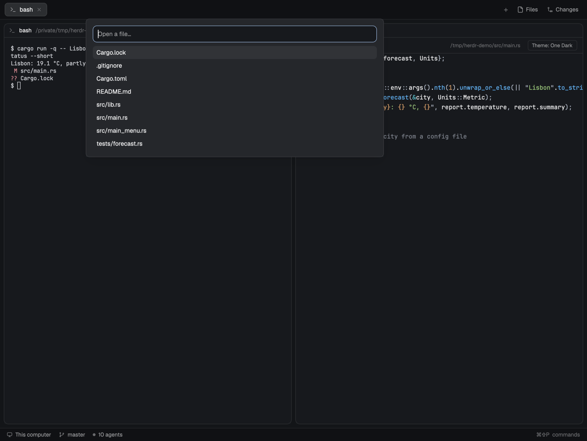

# Herdr Editor

An editor pane for any Herdr layout. Press cmd-o, type part of a file name, and the file opens in an editable pane beside your terminals, with syntax highlighting and line numbers. Press cmd-shift-f to search the folder's files for text and open a match at its line. Save with cmd-s. Unsaved edits are marked, survive closing the pane, and are never written over a file that changed on disk. This is a piece you add to your layout, not a whole window: your layout stays as it is.

To open files by clicking them in the Files panel as well, add [Herdr Editor Files](../files/RECIPE.md) from the same repository.

## What you see

- **Quick open (`herdr-app-editor-open`)**, a popup 640 px wide and 60 % of the window high, 40 px below the top, on `theme().popover` with 14 px padding:
  - a 36 px search field with a 9 px radius and a `theme().accent` border, placeholder "Open a file…"
  - "Showing the first 20000 files" in 11 px `theme().dim` when the folder has more files
  - up to 50 rows of relative paths, 28 px high with a 7 px radius, truncated at the right. The selected row and the hovered row use `theme().hover`.
  - "Loading…", "No files match.", "No folder to search here." or "Cannot list this folder: <error>" in `theme().dim` instead of rows
- **Text search (`herdr-app-editor-search`)**, a popup of the same size and place as quick open:
  - a search field like quick open's, placeholder "Search in files…"
  - "Showing the first 500 matches" or "Stopped early: showing what was found" in 11 px `theme().dim` when they apply
  - rows of 28 px: `path:line` in `theme().dim` (at most 260 px, truncated), then the matching line, trimmed and cut to 200 characters
  - "Type at least 2 characters.", "Searching…", "No matches.", "No folder to search here." or "Cannot search this folder: <error>" in `theme().dim` instead of rows
- **Editor pane (`herdr-app-editor`)**, split to the right of the pane that was focused:
  - Header, 34 px high, 12 px side padding, bottom border `theme().border`. From left to right:
    - a `●` dirty mark in `theme().accent` while the content differs from the file on disk
    - the file name in semibold
    - the full path in 11 px `theme().dim`, right-aligned and truncated
    - "Saving…" while a save runs
    - a 22 px "Theme: <name>" button
  - Banners below the header, one per line with 6 px vertical padding. `info` banners use `theme().surface`, `warn` banners use `theme().raised` and `error` banners use `theme().blocked`. Each banner can carry action buttons (26 px high, 6 px radius, `theme().input` border) to the right of the text. When the text would get less than 320 px, the buttons wrap below it, and in a pane narrower than all the buttons they wrap onto further lines.
  - The code editor (Herdr's `Editor`) at 13 px in the user's terminal font, with line numbers and folding, filling the rest of the pane.
  - An editor pane with no file shows "No file open." and an "Open file…" button, with the key bound to quick open (for example `cmd-o`) beside it in 12 px `theme().dim`.
- **Save dialog:** a modal 440×150 dialog reading "Save changes before opening another file?", with the path and three buttons: Cancel, Don't save, Save.

## How it behaves

- **Quick open:** cmd-o (`mod.open:herdr-app-editor-open`) opens the popup. It lists the files of the focused pane's folder; while an editor pane has focus, the folder of a terminal in the same tab. In a Git repository the list is `git ls-files -co --exclude-standard`, so ignored files are left out. Elsewhere it is every file up to 12 levels down (`find -maxdepth 12`), except inside `.git` and `node_modules`; folders it cannot read are skipped. At most 20000 files are read, and a listing that takes over 10 s is given up.
  - Typing filters the list, ignoring case. A path matches when it contains the typed letters in order. File names that contain the text as typed come first, then file names that contain its letters in order, then other paths. Shorter paths come first within each group.
  - ↑/↓ move the selection, Enter opens the selected file, a click opens a row, Esc closes. Cmd-Enter or cmd-click (ctrl on Linux and Windows) opens the file in a new editor pane.
  - The file opens in the tab that was shown when the popup opened, and the popup closes. If that tab has an editor pane, the file goes there at once. Otherwise the popup closes first and a new editor pane appears right after, split to the right of the pane that was focused. If the `herdr-app` command cannot be found, or `sh` cannot be started, the popup stays open, says so above the list, and Enter can try again.
  - On another machine, the list and the file come from that machine.
- **Text search:** cmd-shift-f (`mod.open:herdr-app-editor-search`) opens the popup. It searches the same folder quick open lists, for the text as typed (not a regular expression). Text in lowercase matches any case; text with an uppercase letter matches case exactly. Searching starts 250 ms after typing stops, from 2 characters. In a Git repository it runs `git grep` over tracked and untracked files, leaving out ignored ones; elsewhere `grep -r`, leaving out `.git` and `node_modules`. Binary files are skipped. At most 500 matches are shown. A search that takes over 10 s is stopped and shows "Cannot search this folder: …" with Herdr's timeout message; nothing found so far is shown, because `exec` returns no output on a timeout. When `grep` could not read some folders, or the output was cut at 8 MiB, what it found is shown with "Stopped early: showing what was found". Only one search runs at a time: text typed meanwhile is searched when it ends.
  - ↑/↓, Enter, cmd-Enter (ctrl-Enter), click and Esc work as in quick open. The file opens with the match selected and scrolled into view.
- **Opening at a line:** an `open` command or split props can carry `at: { line, col?, len? }` (`line` and `col` from 1, in UTF-16 units). The editor selects that place once the file is open. A line past the end goes to the last line. If the file is already open in that pane, the editor only moves there: no save dialog and no reload, and unsaved edits stay. The line numbers come from the file on disk, so with unsaved edits that add or remove lines the place can be off. `at` in split props is used once; after a restart the pane reopens its file without it.
- **Which pane:** a file goes to the most recently focused editor pane in the tab that is registered (it registers when its editor gets focus, or right after its first load when quick open created it). If there is none, a new editor pane is split to the right of the focused pane. In the Files panel, clicks made while a new pane is still being created are queued and replayed in order.
- **Images:** a png, jpg, jpeg, gif, webp, bmp, tif or tiff file is shown as a picture instead of text: a header with the file name and path, and the picture centred below it, scaled down to fit the pane and never scaled up. It cannot be zoomed or edited. Opening the file again shows what is on disk now; a change on disk is not picked up by itself. The picture is shown through a symlink in `~/.config/herdr-app/data/herdr-app-editor/images/`, which the pane removes when it closes (at quit this may not finish in time, leaving a link of a few bytes). An `.svg` opens as text. Images on another machine, and avif or heic files, are not shown. On Windows the file is copied instead of linked, and only files in the home folder can be shown (not yet run there).
- **Other ways to open:** "Open file…" on an empty editor pane registers that pane and opens quick open, so the file comes back to it. An agent or another mod can open a file with `pane.split {direction, mod: "herdr-app-editor", props: {file}}`.
- **Switching files:** if the editor has unsaved edits, the save dialog asks first. Cancel keeps the edits. Don't save discards them and their draft. Save writes them and opens the next file only if the save succeeded. Esc acts as Cancel.
- **Saving:** cmd-s (ctrl-s) saves only when the file's text is still exactly what the editor loaded. If someone else changed it, the save is refused, and a red banner says what a re-read found:
  - the file was deleted
  - the file changed on disk (Reload / Retry)
  - another failure, with the raw error
  - the file cannot be read
  The edits are always kept. CRLF files stay CRLF, because LF lines added with Enter are converted on save. Line endings, a BOM and a missing final newline are otherwise written exactly as they were.
- **External changes:** the open file is polled every 3 s (every 10 s on another machine). Polling happens only while the pane is visible and the window is active, so a change shows up within about 3 s of looking at the pane. A clean editor reloads by itself. An editor with unsaved edits shows "The file changed on disk. Your edits are not saved." with Reload and Keep mine. After Keep mine, the next save is refused until you reload.
- **Drafts:** unsaved edits are written to a draft at most 1 s after typing (250 ms after the last keystroke). After the pane is closed or Herdr restarts, opening the same file offers "An unsaved draft from <time> exists." with Restore draft and Discard draft. The banner notes when the file changed since the draft was taken. Restore draft moves the draft to the pane that restored it, so saving or discarding there removes it.
- **Pane state:** each editor pane remembers the file it shows (`data/herdr-app-editor/panes/<key>`), so it reopens that file after a restart. A pane opened without a `key` prop gets one for the session only; after a restart it reopens the file it was created with. A closed pane cannot remove its own record, because `close()` cannot tell closing a pane from quitting the app. Instead, 60 s after the first editor starts, records that no pane has written for 90 days are deleted. Each record is read, judged and deleted as one queued store operation, so a pane saving its record at the same moment keeps it. Records written before this sweep existed have no timestamp; the sweep gives them one and the full 90 days.
- **Read-only cases** (an `info` banner, no editing; the cursor still shows, and text can be selected and copied): files on another machine; files the user cannot write (checked with `test -w`, or the read-only attribute on Windows); files whose write permission cannot be checked; files an extension marks read-only.
- **Files that do not open** (message instead of an editor): larger than 1 MiB, not valid UTF-8, or containing NUL bytes.
- **Highlighting:** files over 30 KB open without highlighting, with the banner "Syntax highlighting is off for files over 30 KB to keep typing fast." and a "Highlight anyway (slower typing)" button. Herdr re-parses the whole file on every keystroke, about 1.8 ms per KB.
- **Themes:** the Theme button cycles through Herdr (colors taken from the app theme), then the built-in themes that match the app's light or dark mode. Those are One Dark, Dracula and Nord in dark mode, and GitHub Light in light mode. The choice applies to every editor pane within 1 s. Switching themes clears undo, because Herdr's editor cannot recolor in place.

## Built from

- `mods/herdr-app-editor` (`focusable: true`): `EditorState` / `Editor` from `gpui-base`; `readTextFile`, `writeTextFile(path, text, expected)`, `exec("test", ["-w", path])`; `image()` from `gpui-kit` for pictures, with `exec` of `test -f`, `ln -s` and `rm -f` for their links; `nextCommand()` for `open`, `reply` and `focus`; `openOverlay({ kind: "dialog", modal: true })` for the save dialog. The dialog is the same mod with props `role: "dialog"`, and it replies from `close()`. Drafts and pane state live under `appHome()/data/herdr-app-editor/` as A/B slot files written through `fs/promises`. The empty pane's key label comes from `keys()`.
- `mods/herdr-app-editor-open` (`focusable: true`, overlay `{ kind: "popup", at: "top", offset: 40, width: 640, height: 0.6 }`): `InputState` / `Input` from `gpui-base`; `exec("git", ["ls-files", "-co", "--exclude-standard", "-z"], { cwd, on })`, falling back to `exec("find", [".", "-maxdepth", "12", "(", "-name", ".git", "-o", "-name", "node_modules", ")", "-prune", "-o", "-type", "f", "-print0"], { cwd, on })` (its output is used even when it exits non-zero), both with `timeout: 10000`; `closeOverlay(<the id read from props().overlay in init()>)`. It never creates a pane itself. For a new editor pane it runs `exec("sh", ["-c", SPLIT_SCRIPT, "sh", <pane.split args JSON>, appHome(), "herdr-app-editor-open"])`. The script exits 3 at once if `herdr-app` is neither on `PATH` nor at `~/.local/bin/herdr-app`; otherwise it returns and, in the background, polls `herdr-app status` until the overlay is no longer listed (at most 60 checks 50 ms apart, about 3 s plus the time the checks take), then runs `herdr-app do pane.split <args>` (`HERDR_APP_HOME` set to the app home). The arguments are positional, never pasted into the script. The split's props carry `tab` and `before` (the editor panes that existed); after its first load the new pane registers itself as the one editor pane in that tab not in `before`, because nobody else can. Registering a key drops any other key naming the same pane.
- Opening a file into an existing editor pane, in both mods: `run("pane.focus", { pane })` followed by `run("herdr-app-editor.open:<json>")` for an existing editor pane. A new pane comes from `pane.split { pane, direction: "right", mod: "herdr-app-editor", props: { key, file, on } }`; the opener finds the new pane by comparing `panes()` before and after, and records `{ key → pane, tab, lastFocus }` under `shared("herdr-app-editor").registry`.
- `mods/herdr-app-editor-search` (the same `mod.json` as quick open): `exec("git", ["rev-parse", "--is-inside-work-tree"], { cwd, on })` once; then `exec("git", ["grep", "-n", "-I", "--column", "--no-color", "--untracked", "-z", "-F", ["-i"], "-e", <text>])` in a Git work tree, otherwise `exec("grep", ["-rnI", "--null", "-F", ["-i"], "--exclude-dir=.git", "--exclude-dir=node_modules", "-e", <text>, "."])`, all with `{ cwd, on, timeout: 10000 }`. `git grep`'s byte column is turned into a UTF-16 column. Output after the last newline is dropped, and output that ends mid-line (Herdr keeps 8 MiB) counts as stopped early. It opens files like quick open, with `at` added, and passes `"herdr-app-editor-search"` to `SPLIT_SCRIPT`.
- `keys.json`: `{ "global": { "cmd-o": "mod.open:herdr-app-editor-open", "cmd-shift-f": "mod.open:herdr-app-editor-search" } }`.
- The source is TypeScript in `src/` of the repository, bundled with `bun build --target node --format esm`. The externals are `herdr`, `gpui-kit`, `gpui-base` and `fs/promises`. Themes are `editor-themes/*.json`. The only programs run are `git`, `find`, `grep`, `test` (or PowerShell on Windows), `ln` and `rm` for image links (on Windows the image is copied with the host fs instead), and `sh` with `herdr-app` for a new editor pane from quick open or text search.

## Watch out

- **Tell the person before installing.** No Internet access; in a space on another machine it runs its commands and reads files on that machine. It runs `git` or `find` to list the file names of the focused folder, `git grep` or `grep` to search the text of its files, `test -w` (PowerShell on Windows instead) to check write permission, `test -f`, `ln -s` and `rm -f` to link an opened image into `data/herdr-app-editor/images/` and remove the link, and `sh` with `herdr-app status` and `herdr-app do pane.split` for a new editor pane from quick open or text search. It reads and writes the files the person opens, keeps drafts, pane state and image links in `data/herdr-app-editor/`, and keeps a registry of editor panes in the shared state `herdr-app-editor`.
- **Ask for the keys before merging `keys.json`, in one question.** Text search defaults to `cmd-shift-f` (VS Code, Zed and JetBrains use it for Find in Files); on Linux and Windows suggest `ctrl-shift-f`. Quick open defaults to `cmd-o`. Offer `cmd-p` (VS Code, Zed, Sublime Text and Cursor use it for opening files by name; in Herdr it opens the tab picker, `mod.open:picker`, so say so and ask whether to move the picker to another key) and `cmd-shift-o` (JetBrains' Go to File and Xcode's Open Quickly; VS Code uses it for symbols). Any other key works too. If the chosen key is already bound, ask before replacing it. Tell the person that editing `keys.json` makes the whole file theirs: later Herdr updates no longer add new default shortcuts to it. The key can be changed later in `keys.json`. The binding is macOS's; on Linux and Windows ask for a key, and avoid plain `ctrl-<letter>` (it goes to terminal programs) and `ctrl-shift-o` (Herdr's split on those systems).
- **Do not create a pane from an overlay.** On Herdr 0.1.16 a pane created while an overlay is open is tied to that overlay: when the overlay closes, the pane's first file reads never finish (it stays on "Loading…") and the `EditorState` it made is released ("this editor state has been released and can no longer be rendered"). This holds whether the overlay calls `pane.split` itself or runs `herdr-app do pane.split` while it is open. Splitting after the overlay has closed works, hence the detached command. The overlay sending `open` to an existing editor pane is fine.
- Read `props()` in `init()`. On Herdr 0.1.16 it can return `{}` once an `await` has passed, so the new pane keeps `before` and `tab` from `init()` for registering itself later.
- Build with `--target node`. `--target browser` silently replaces `fs/promises` with an empty object, and `herdr-app check` still passes.
- The editor cannot learn its own pane id in `init()`, because `focused()` still points at the pane that ran the split. Register the pane from the side that split it. While the quick open popup is shown, `focused()` still reports the pane underneath it.
- Herdr 0.1.16 can create a copy of a pane's mod and drop it at once, so `init()` runs twice for one new pane and the dropped copy's tasks never wake. Do not set a once-per-module flag before an `await` in `init()`.
- `<mod>.<command>` reaches every shown copy, dialog overlays included, so every message carries a `to` key. A command sent to a copy that is not shown shows an error toast.
- `writeTextFile` replaces read-only files when the folder is writable, and hard links and extended attributes are lost. Check write permission before saving.
- `EditorState` cannot change language or colors, and `set_value()` clears undo and fires no `change` event.
- `fs.writeFile` calls must not overlap, or files get corrupted.
- The names `herdr-app-editor`, `herdr-app-editor-open` and `herdr-app-editor-search` are compiled into the code: command targets, the shared key and the data folder. If a name is taken, do not rename the copied folders; change `src/core/names.ts` and rebuild (`bun run build`).
- **Removing it:** close the editor panes, delete `mods/herdr-app-editor`, `mods/herdr-app-editor-open` and `mods/herdr-app-editor-search`, and remove both keys from `keys.json`. If the folders are deleted while editor panes are open, those panes show "no mod folder" after the next start. Unsaved drafts stay in `data/herdr-app-editor/` until you delete it. Herdr has no API to delete a `shared` key, so `"herdr-app-editor"` stays in shared state.
- Requires Herdr Desktop 0.1.16 or later; check `herdr-app --version` first (`EditorState.focus`, `checking()`, `watchFolder().cancel()`). Tested on macOS only. Linux and Windows are untested, including the Windows paths and permission checks.

## Done when

- `herdr-app check` passes for `mods/herdr-app-editor`, `mods/herdr-app-editor-open` and `mods/herdr-app-editor-search`.
- In the person's layout, cmd-o lists the focused folder's files; typing narrows the list and Enter opens the file in a new editor pane. Closing that pane and opening a file again with cmd-o works the same way, and the pane still shows the file seconds later.
- Cmd-shift-f, then typing text found in the folder, lists the matches; Enter opens the file with the match selected. Picking a second match in the same file moves there without reloading, and unsaved edits stay.
- Editing shows `●`. Cmd-s writes the file and the `●` disappears.
- An editor pane opened with `pane.split {mod: "herdr-app-editor"}` and no props shows "Open file…" and the bound key; choosing a file there opens it in that pane.
- With unsaved edits, opening another file asks first, and Cancel keeps the edits.
- Changing the file from a shell while it has unsaved edits shows the changed-on-disk banner. Saving after Keep mine is refused, and the file on disk is unchanged.
- Closing the pane with unsaved edits and opening the file again offers to restore the draft.
- A CRLF file stays CRLF after adding lines and saving.
- A `chmod 444` file opens read-only.
