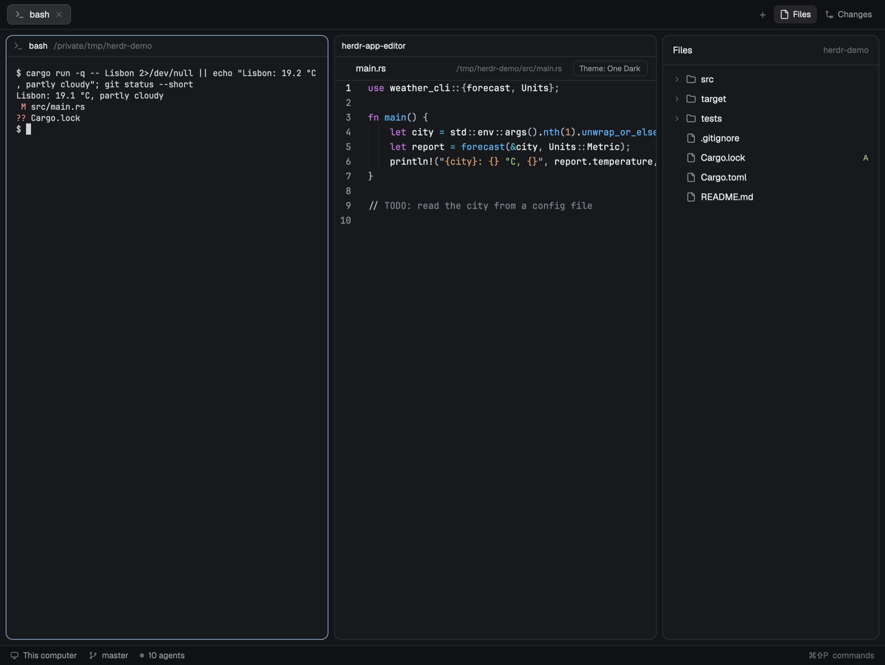

# Herdr Editor Files

Herdr's Files panel, changed so that clicking a file opens it in [Herdr Editor](../editor/RECIPE.md), an editable pane with syntax highlighting, line numbers and cmd-s to save. Without Herdr Editor installed, a click shows a read-only preview in the panel, as Herdr's own Files panel does. This is a piece you add to your layout, not a whole window: it takes the place of the Files panel in the layout you already use.

## What you see

- The same panel as Herdr's Files: a 42 px header with the folder name, then the tree with the same 28 px rows, 18 px indentation per level, 12 px chevrons, 14 px folder and file icons and git marks (`A` in `theme().ansi2`, `D` and `U` in `theme().ansi1`, others in `theme().blocked`).
- With Herdr Editor installed, a clicked file opens in an editor pane to the right of the focused pane, not inside the panel.
- Without it, the clicked file's read-only preview fills the panel, as in Herdr's Files. Its text is in the terminal font at the terminal's size (`font_size`); Herdr 0.1.16's own Files shows it at 12 px.

## How it behaves

- **Folder:** the panel follows the folder of the focused terminal. While an editor pane has focus, it follows a terminal in the same tab instead, so the tree does not jump away while you edit.
- **Clicking a file:** opens it in the most recently focused editor pane in the current tab. If there is none, a new editor pane is split to the right. Cmd-click (ctrl-click on Linux and Windows) always opens a new editor pane, so two files can be edited side by side. Clicks made while a new pane is still being created are queued and replayed in order.
- **Without Herdr Editor:** the panel checks for `mods/herdr-app-editor/mod.json` in the app home when a file is clicked (at most every 5 s per panel). If it is not there, the click shows the read-only preview instead.
- **Folders** expand and collapse on click; their contents load when expanded. The panel watches the shown folder and refreshes on changes, and stops watching when the folder changes or the panel closes.

## Built from

- `mods/herdr-app-editor-files` (`place: "none"`): a fork of Herdr's `files` mod (herdrdev/herdr-app `defaults/mods/files/main.js`, `317e673`), Apache-2.0, with Lucide icons under ISC. The changes are marked `herdr-app-editor:` in the repository's `src/entries/editor-files.js` and listed at the top of `main.js`: the click handler, the icon paths (`mods/herdr-app-editor-files/*.svg`), following a terminal while an editor is focused, cancelling the folder watch, and the fallback to the preview.
- It opens files with `run("pane.focus", { pane })` followed by `run("herdr-app-editor.open:<json>")`. A new pane comes from `pane.split { pane, direction: "right", mod: "herdr-app-editor", props: { key, file, on } }`; the panel finds the new pane by comparing `panes()` before and after, and records `{ key → pane, tab, lastFocus }` under `shared("herdr-app-editor").registry`.
- It reads files with `readTextFile` and folders with `exec` (`git` and `sh`), and watches with `watchFolder`, like Herdr's Files.

## Watch out

- **Putting it in the layout.** Change the Files block's content in the person's layout from `{ "mod": "files" }` to `{ "mod": "herdr-app-editor-files" }`. Herdr's own layouts are read-only: if the person uses `main` (or another shipped layout), clone it first (`herdr-app do layout.clone '{"name":"main","as":"<name>"}'`, which also switches to the clone) and change the clone. If the layout has no Files block, ask the person where the panel should go. To undo, set the block back to `{ "mod": "files" }`.
- The panel opens files in Herdr Editor's pane. Install [Herdr Editor](../editor/RECIPE.md) from the same repository for that; without it, a click shows the read-only preview in the panel.
- The names `herdr-app-editor-files` and `herdr-app-editor` are compiled into the code: the command target, the shared key and the icon paths. If a name is taken, do not rename the copied folder; change `src/core/names.ts` in the repository and rebuild (`bun run build`).
- Keep `LICENSE` and `LICENSE-Lucide.txt` in the folder and the modification notice at the top of `main.js` (Apache-2.0 §4).
- **Removing it:** set the Files block back to `{ "mod": "files" }` first, then delete `mods/herdr-app-editor-files`.
- Requires Herdr Desktop 0.1.16 or later. Tested on macOS only.

## Done when

- `herdr-app check` passes for `mods/herdr-app-editor-files`.
- With the block changed in the person's layout, the panel shows the focused terminal's folder with git marks.
- With Herdr Editor installed, clicking a file opens it in an editor pane; cmd-click opens a second editor pane.
- Without Herdr Editor, clicking a file shows its read-only preview in the panel.
